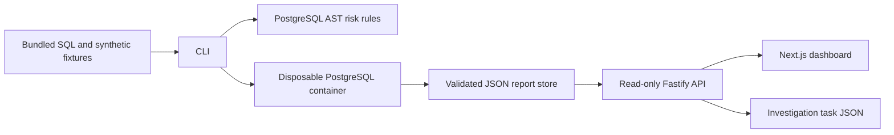

# Architecture

## Rehearsal lifecycle

1. Validate the scenario identifier and load the repository-owned SQL and expected checks. The static analyzer parses PostgreSQL 17 SQL into an AST, then applies rules per statement.
2. Launch the pinned PostgreSQL image on the local Docker daemon. The startup process creates a restricted role and independently owned proposal and correction databases in the same ephemeral container.
3. Create the schema, insert deterministic synthetic fixtures, and collect catalog, integrity, compatibility and, where configured, query-plan evidence.
4. Execute the proposed migration in a transaction. Capture PostgreSQL’s command tags or SQLSTATE. Commit on success and roll back on error. The contention fixture also uses independent blocker and observer connections.
5. Collect the post-attempt catalog and rerun checks. Test the correction on the second database initialized from the same fixtures. The destructive drop scenario ends with a required recovery review.
6. End connections and remove the container. Validate the evidence shape and write one JSON file per UUID. Files publish atomically using an exclusive hard link after the temporary file is complete.

A report can contain a verified fixture and a confirmed failure at the same time. Fixture verification means the expected observations occurred. The report separately records structural risks, potential risks, confirmed execution failures, and production assumptions.

## Local API

| Method and path | Response |
| --- | --- |
| `GET /health` | API process health |
| `GET /scenarios` | Bundled inventory and static risk classifications |
| `GET /runs` | Most recent 100 report summaries |
| `GET /runs/:id` | Validated report JSON |
| `GET /runs/:id/task` | Investigation task generated from a saved report |

The dashboard fetches the API on the server over loopback. Its same-origin artifact routes send JSON as attachments. All rehearsal operations go through the CLI. The report format is versioned and includes SQL, artifact hashes, catalog snapshots, typed outcomes, and review status.

## Official references

- [Node.js release support](https://nodejs.org/en/about/previous-releases)
- [PostgreSQL client timeouts](https://www.postgresql.org/docs/17/runtime-config-client.html) and [EXPLAIN](https://www.postgresql.org/docs/17/sql-explain.html)
- [node-postgres client](https://node-postgres.com/apis/client) and [Docker resource constraints](https://docs.docker.com/engine/containers/resource_constraints/)
- [Fastify routes](https://fastify.dev/docs/latest/Reference/Routes/) and [Next.js installation requirements](https://nextjs.org/docs/app/getting-started/installation)
- [Vitest guide](https://vitest.dev/guide/) and [Playwright web-server configuration](https://playwright.dev/docs/test-webserver)
- [GitHub Actions workflow syntax and permissions](https://docs.github.com/en/actions/reference/workflows-and-actions/workflow-syntax)
